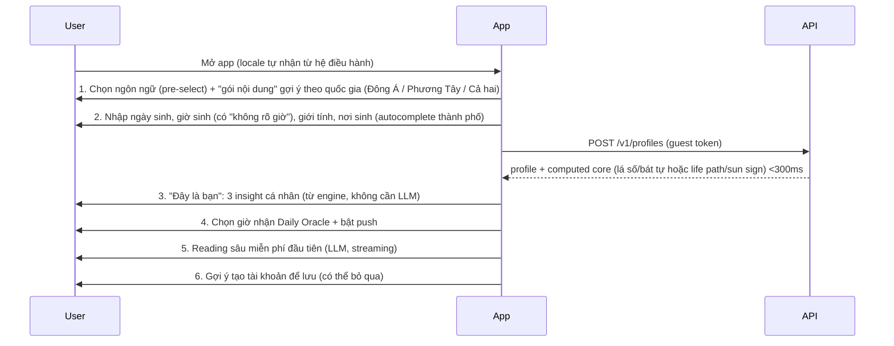

# B2 — Pain point & luồng sản phẩm tương ứng

> Mỗi pain point gắn với bằng chứng (file 01) và một luồng (flow) cụ thể. Luồng vẽ bằng Mermaid để dán thẳng vào Figma/FigJam hoặc docs.

## 1. Bản đồ pain point → giải pháp → luồng

| # | Pain point | Bằng chứng | Giải pháp | Luồng | Đo bằng |
|---|---|---|---|---|---|
| P1 | "Mỗi sáng tôi muốn biết nhanh hôm nay thế nào, không muốn mở 3 app" | Lịch Vạn Niên 15M tải; Jeomsin 17–19M; Co-Star nổi nhờ push ngày | **Daily Oracle** 1 màn hình, <5 giây đọc xong, push đúng giờ chọn | F2 | DAU/MAU, D7, open-rate push |
| P2 | "Lập lá số online hay sai giờ/sai lịch; chatbot AI bịa" | tinhmenhdo bài 3/2026; lịch VN ≠ TQ (Tết 1985 lệch 1 tháng; 2007, 2030 lệch 1 ngày – đã chạy thử, file 03) | Engine tất định theo chuẩn quốc gia + nơi sinh (kinh độ, DST, giờ mặt trời thực); AI chỉ diễn giải JSON | F1, F3 | Tỷ lệ "báo sai" <0,5%; golden test pass 100% |
| P3 | "Nhập ngày sinh xong chả thấy gì hay, phải trả tiền mới xem được" | Review Co-Star 2026: cơ bản cũng paywall | **Aha trong 90 giây**: 1 reading sâu miễn phí đầu tiên + 3 insight cá nhân ngay sau onboarding | F1 | Onboarding completion ≥70%; time-to-aha ≤90s |
| P4 | "Bị lừa gói 1 USD rồi auto-renew 49 USD; tính tiền khi đang chờ" | FTC kiện OBRIO 2026; review Sanctuary | Paywall ghi giá đầy đủ + ngày gia hạn, nhắc trước khi hết trial (push + email), huỷ 1 chạm, không tính phí chờ | F4 | Refund rate <2%; trial→paid ≥25% |
| P5 | "Push quá nhiều, nhảm" | Review Co-Star: "great when you get one a week" | Mặc định 1 push/ngày đúng giờ user chọn; nội dung = Daily Oracle thật; tắt theo loại | F2 | Opt-out push <15% |
| P6 | "Tôi muốn hỏi chuyện tình cảm/hợp đôi" | 85% câu hỏi ở Nhật về tình cảm; compatibility là IAP phổ biến | Compatibility (hợp tuổi Đông Á / synastry-numerology Tây) + Ask AI có ngữ cảnh 2 hồ sơ | F5 | % paid từ compatibility |
| P7 | "Cần chọn ngày cưới/khai trương/ký hợp đồng hợp tuổi" | Mùa vụ VN; dịch vụ xem ngày phổ biến CJK | Date Picker: lọc ngày tốt theo việc + tuổi 1–2 người, xuất ra calendar | F6 | Số ngày được lưu/xuất |
| P8 | "App nước ngoài không hiểu văn hoá tôi; dịch máy ngô nghê" | Thuật ngữ huyền học khó dịch | Locale ≠ tradition pack; glossary + reviewer bản địa; giọng văn theo locale | xuyên suốt | CSAT bản dịch ≥4,3/5 |
| P9 | "Không muốn giao ngày sinh cho app lạ" | tinhmenhdo không lưu; Surfshark privacy ranking | Dùng không cần tài khoản (guest), mã hoá at-rest, nút xoá dữ liệu 1 chạm | F1 | % guest→account; số yêu cầu xoá |
| P10 | "Muốn khoe/so với bạn" | Co-Star viral nhờ share; social-driven | Share card (ảnh đẹp, không lộ ngày sinh), deep link mời bạn làm compatibility | F5 | K-factor, share rate |

## 2. Kiến trúc luồng tổng thể

```mermaid
flowchart LR
  A[Mở app lần đầu] --> B[F1 Onboarding<br/>locale → gói nội dung → ngày sinh]
  B --> C[Aha: 3 insight + 1 reading sâu free]
  C --> D[F2 Today / Daily Oracle]
  D -->|mỗi ngày| D
  D --> E[F3 Explore: Tử Vi / Bát Tự / Tarot / Numerology / Kinh Dịch]
  E --> F[F4 Soft paywall<br/>trial 7 ngày hoặc credit]
  D --> G[F5 Compatibility & Ask AI]
  G --> F
  D --> H[F6 Date Picker (xem ngày)]
  H --> F
  F --> I[Plus member]
  I --> D
```

## 3. Chi tiết từng luồng

### F1 — Onboarding (mục tiêu: aha ≤90 giây, ≤6 màn hình)


Quy tắc: không hỏi email trước khi có giá trị; "không rõ giờ sinh" vẫn cho kết quả (Tử Vi cảnh báo độ tin cậy; numerology/tarot không cần giờ).

### F2 — Daily Oracle (tính năng free hằng ngày)

Nội dung theo gói:
- **Đông Á (vi/zh/ko/ja):** ngày âm + can chi, hoàng đạo/hắc đạo, giờ tốt, việc nên/kiêng (宜/忌) đã **lọc theo tuổi** user (xung/hợp), sao ngày (nhị thập bát tú, trực), con số/màu may mắn (từ ngũ hành ngày vs mệnh), 1 câu "chuyển vận" do LLM viết từ JSON. Thêm 1 lá Tarot nếu user bật "Cả hai".
- **Phương Tây (en/es/pt):** 1 lá Tarot ngày (RWS), số ngày cá nhân (personal day number) + ý nghĩa, Mặt Trăng ở cung nào hôm nay, 1 câu "focus" do LLM viết.
- Cả hai: streak, nút share card, nút "Hỏi thêm" (Ask AI, 3 câu/ngày free).

```mermaid
flowchart TD
  J[Job 00:05 giờ địa phương từng múi] --> K[Engine tính dữ liệu ngày cho mỗi segment<br/>segment = (locale, tradition, năm sinh can chi hoặc life path, sun sign)]
  K --> L[LLM viết 1–2 câu / segment, cache 24h]
  L --> M[(daily_content)]
  M --> N[Push đúng giờ user chọn]
  N --> O[Màn Today: render từ cache, 0 LLM call]
```
Chi phí: số segment Đông Á ≈ locale × 60 can chi năm ≈ 300; phương Tây ≈ locale × 9 life path × 12 sun sign ≈ 650 → <1.000 LLM call/ngày, không phụ thuộc số user.

### F3 — Reading sâu (Tử Vi / Bát Tự / Tarot spread / Numerology report / Kinh Dịch)

1. Chọn môn → (Tarot: chọn câu hỏi + trải bài; Kinh Dịch: gieo 6 lần có animation; Tử Vi/Bát Tự: dùng hồ sơ sẵn).
2. Engine trả JSON chuẩn (`ReadingInput`), render biểu đồ ngay (lá số 12 cung / 4 trụ / bài / số).
3. LLM diễn giải theo **template có cấu trúc** (tổng quan → từng phần → hành động) với giới hạn: chỉ dùng facts trong JSON, không khẳng định tương lai tuyệt đối, có disclaimer locale-aware.
4. Lưu reading, cho phép hỏi tiếp (Ask AI gắn reading làm context).
5. Lần đầu: miễn phí. Từ lần 2: soft paywall (F4), hoặc 1 credit.

### F4 — Soft paywall & thanh toán minh bạch

- Hiển thị khi: reading sâu lần 2+, compatibility chi tiết, Ask AI quá 3 câu, Date Picker nâng cao, lịch sử >7 ngày.
- Màn paywall: 3 gói (tuần/tháng/năm – năm làm "best value"), giá nội tệ, dòng chữ "Gia hạn tự động … Huỷ bất kỳ lúc nào trong Cài đặt", nút "Dùng 1 credit thay vì đăng ký".
- Trial 7 ngày: push + email nhắc trước 24h khi hết trial (tuân Apple/Google + tránh vết xe FTC).
- Restore purchase, quản lý gói, huỷ trong app (deep link tới store).

### F5 — Compatibility & Ask AI

- Thêm hồ sơ thứ 2 (người yêu/đối tác/con) hoặc mời qua link; tính: Đông Á = hợp/xung can chi, ngũ hành, cung Phu Thê; Tây = life path pairing + Sun/Moon/Venus (wave 2).
- Ask AI: chat có system prompt chứa JSON 2 hồ sơ + reading gần nhất; trả lời bằng locale user; chặn chủ đề y tế/pháp lý/tài chính cụ thể (guardrail), gợi ý chuyên gia khi cần.

### F6 — Date Picker (xem ngày theo việc)

- Chọn việc (cưới, khai trương, nhập trạch, ký kết, xuất hành, cầu tài…), khoảng ngày, tuổi 1–2 người → trả danh sách ngày tốt xếp hạng với lý do (宜 khớp việc, không xung tuổi, trực/sao tốt, giờ hoàng đạo) → lưu/xuất .ics.

## 4. Anti-pattern phải tránh (rút từ đối thủ)

1. Không khoá tính năng cơ bản (lá số, 4 trụ, 1 lá bài) sau paywall.
2. Không "mồi 1 USD" rồi auto-renew gói lớn mà không hiển thị rõ.
3. Không tính phí thời gian chờ; không dark pattern khi huỷ.
4. Không gửi >1 push/ngày mặc định; không push lúc đêm theo múi giờ user.
5. Không để LLM tự tính lá số; không hứa hẹn tuyệt đối (sức khoẻ, pháp lý, tài chính).
6. Không lưu ngày sinh dạng plain text; cho phép dùng guest.
7. Không dùng chữ "for entertainment purposes" làm lá chắn chính sách; mô tả store phải khớp chức năng.

## 5. Bộ chỉ số (North Star & guardrail)

- **North Star:** số "Daily Oracle đã đọc" / tuần (proxy cho thói quen).
- Input metrics: onboarding completion, time-to-aha, D1/D7/D30, push opt-in, reading sâu/user, trial start, trial→paid, credit mua, RPI 60 ngày.
- Guardrail: refund rate, store rating ≥4,5, báo lỗi tính toán, chi phí LLM/DAU ≤0,01 USD.
